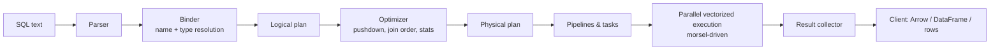
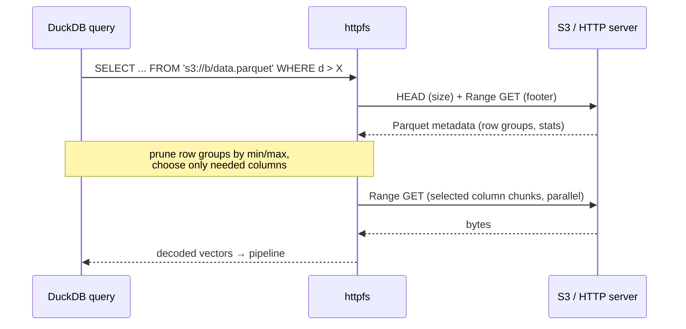
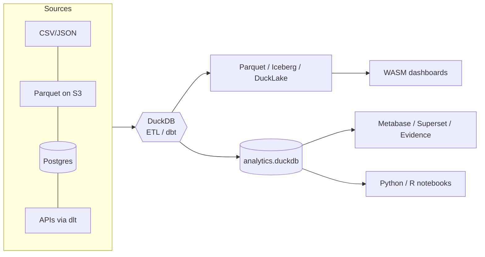

# DuckDB – Reference Card & Cheat Sheet

> In-process analytical (OLAP) SQL database. "SQLite for analytics."
> Single binary / library, zero dependencies, columnar, vectorized, MIT licensed.
> Note: verify version-specific details at <https://duckdb.org/docs> (the project releases frequently; 1.x line with LTS releases).

---

## Table of Contents

1. [Overview & Basics](#1-overview--basics)
2. [Quick Start](#2-quick-start)
3. [Core Concepts](#3-core-concepts)
4. [Architecture](#4-architecture)
5. [Storage & File Format](#5-storage--file-format)
6. [Protocols & Data Access](#6-protocols--data-access)
7. [Clients & Tools](#7-clients--tools)
8. [Supported Formats](#8-supported-formats)
9. [SQL Cheat Sheet](#9-sql-cheat-sheet)
10. [Extensions](#10-extensions)
11. [Configuration & Tuning](#11-configuration--tuning)
12. [Code Snippets by Language/Platform](#12-code-snippets-by-languageplatform)
13. [Typical Use Cases](#13-typical-use-cases)
14. [Pros & Cons](#14-pros--cons)
15. [Comparison with Other Systems](#15-comparison-with-other-systems)
16. [Pitfalls & Best Practices](#16-pitfalls--best-practices)
17. [Resources](#17-resources)

---

## 1. Overview & Basics

| Property | Value |
|---|---|
| Type | Embedded (in-process) analytical relational DBMS |
| Workload | OLAP: scans, aggregations, joins, window functions |
| Execution model | Columnar storage, vectorized push-based execution, morsel-driven parallelism |
| Language | C++ (core), SQL dialect close to PostgreSQL |
| License | MIT |
| Deployment | Library linked into your process; also CLI, WASM in browser |
| Persistence | Single-file database (`.duckdb` / `.db`) or in-memory (`:memory:`) |
| Concurrency | Many readers + one writer process (MVCC, optimistic concurrency within a process) |
| Transactions | ACID, snapshot isolation (MVCC), WAL |
| Dependencies | None (statically linked) |
| Governance | DuckDB Foundation + DuckDB Labs; MotherDuck as commercial cloud offering |

### Key ideas in one minute

- **No server.** The database engine runs inside your Python/R/Java/Node/… process.
- **Query files directly.** `SELECT * FROM 'data.parquet'` – no import needed.
- **Fast on a laptop.** Vectorized engine, parallel, out-of-core capable (spills to disk).
- **Interop.** Zero-copy with Arrow, pandas, Polars via Arrow / replacement scans.
- **Extensible.** Core is small; features (httpfs, spatial, iceberg, delta, postgres…) come as extensions.

---

## 2. Quick Start

### Install

```bash
# macOS
brew install duckdb
# Windows
winget install DuckDB.cli
# Linux (script) – or download binary from duckdb.org
curl https://install.duckdb.org | sh

# Language packages
pip install duckdb
npm install @duckdb/node-api        # modern Node client
install.packages("duckdb")          # R
# Java: Maven  org.duckdb:duckdb_jdbc
# Rust: cargo add duckdb --features bundled
# Go:   go get github.com/marcboeker/go-duckdb   (community)
# C#:   dotnet add package DuckDB.NET.Data.Full
```

### CLI session

```bash
duckdb                 # in-memory
duckdb mydb.duckdb     # persistent
duckdb -c "SELECT 42"  # one-shot
duckdb -json -c "SELECT * FROM 'x.csv' LIMIT 3"
```

```sql
.help                    -- dot commands
.tables                  -- list tables
.schema mytable
.mode markdown           -- output formats: duckbox, csv, json, markdown, table, line ...
.timer on
.read script.sql
.open other.duckdb
.exit
```

### 30-second demo

```sql
-- query a file with no import
SELECT country, count(*) AS n, avg(price) AS avg_price
FROM 'sales_*.parquet'
GROUP BY country
ORDER BY n DESC;

-- create table from CSV (auto-detects types, header, delimiter)
CREATE TABLE trips AS SELECT * FROM read_csv('trips.csv');

-- export
COPY (SELECT * FROM trips WHERE fare > 50) TO 'out.parquet' (FORMAT parquet, COMPRESSION zstd);
```

---

## 3. Core Concepts

| Concept | Explanation |
|---|---|
| **In-process** | Engine runs in the host application's address space. No network hop, no auth layer. |
| **Database file** | One file holds catalog + data (plus a `.wal` file while writing). |
| **In-memory DB** | `:memory:` – lost on exit. Default in most client libs if no path given. |
| **Catalog** | Databases → Schemas → Tables/Views/Sequences/Macros/Types. `main` is default schema. |
| **Attach** | `ATTACH 'x.duckdb' AS x;` mount multiple DBs, incl. Postgres/MySQL/SQLite via extensions. |
| **Replacement scan** | Referencing an unknown table name resolves to a Python DataFrame, Arrow table, file path, etc. |
| **Table functions** | `read_csv`, `read_parquet`, `read_json`, `glob`, `range`, `unnest`, `generate_series`, … |
| **Vector** | Batch of values (default 2048) processed at once – basis of vectorized execution. |
| **Row group** | Storage unit of ~122,880 rows; has min/max zonemaps, compressed per column segment. |
| **Morsel** | Work unit handed to a thread in the parallel scheduler. |
| **Pipeline** | Chain of operators with no blocking boundary; pipelines are scheduled as tasks. |
| **Out-of-core** | Hash joins, aggregations, sorts can spill to a temp directory when exceeding `memory_limit`. |
| **Secrets** | Managed credentials for S3/GCS/Azure/HTTP/etc. (`CREATE SECRET`). |
| **Macros** | SQL-level reusable functions: `CREATE MACRO f(x) AS x*2;` incl. table macros. |
| **Nested types** | `LIST`, `STRUCT`, `MAP`, `ARRAY` (fixed-size), `UNION` – first-class citizens. |
| **Friendly SQL** | `SELECT * EXCLUDE(...)`, `GROUP BY ALL`, `FROM x` w/o SELECT, `QUALIFY`, `PIVOT`, trailing commas… |

### Type overview

```
Numeric   : TINYINT SMALLINT INTEGER BIGINT HUGEINT UHUGEINT UTINYINT.. FLOAT DOUBLE DECIMAL(p,s)
Text      : VARCHAR (STRING/TEXT) , BLOB, BIT, ENUM
Temporal  : DATE TIME TIMESTAMP TIMESTAMPTZ TIMESTAMP_S/MS/NS INTERVAL TIMETZ
Boolean   : BOOLEAN
Special   : UUID, JSON (extension), GEOMETRY (spatial ext)
Nested    : T[] (LIST), T[n] (ARRAY), STRUCT(a INT, b VARCHAR), MAP(K,V), UNION(...)
```

---

## 4. Architecture

### 4.1 Big picture (layers)

```
┌──────────────────────────────────────────────────────────────────────┐
│                    HOST PROCESS (your application)                   │
│                                                                      │
│  Python / R / Java / Node / Go / Rust / C# / C / C++ / WASM / CLI    │
│        │ (client API: connect(), query(), execute(), Appender)       │
│  ┌─────▼────────────────────────────────────────────────────────┐    │
│  │                     DuckDB Engine (libduckdb)                │    │
│  │                                                              │    │
│  │  Parser (PG parser fork) ─► Binder ─► Logical Planner        │    │
│  │            │                                  │              │    │
│  │            ▼                                  ▼              │    │
│  │     Optimizer (rule + cost based: filter pushdown,           │    │
│  │     join order, common subexpr, statistics propagation,      │    │
│  │     projection pushdown, top-N, unnest rewrite …)            │    │
│  │            │                                                 │    │
│  │            ▼                                                 │    │
│  │     Physical Planner ─► Pipelines ─► Task Scheduler          │    │
│  │            │                         (thread pool, morsels)  │    │
│  │            ▼                                                 │    │
│  │   Vectorized Execution Engine (2048-row vectors)             │    │
│  │            │                                                 │    │
│  │  ┌─────────▼───────────┐   ┌────────────────────────────┐    │    │
│  │  │ Buffer Manager      │   │ Transaction Mgr (MVCC),    │    │    │
│  │  │ (memory_limit,      │   │ WAL, Checkpointing         │    │    │
│  │  │  spill to temp dir) │   └────────────────────────────┘    │    │
│  │  └─────────┬───────────┘                                     │    │
│  │            │      ┌─────────────────────────────────────┐    │    │
│  │            │      │ Extension loader (httpfs, parquet,  │    │    │
│  │            │      │ json, spatial, iceberg, postgres…)  │    │    │
│  │            │      └─────────────────────────────────────┘    │    │
│  └────────────┼─────────────────────────────────────────────────┘    │
└───────────────┼──────────────────────────────────────────────────────┘
                ▼
   ┌───────────────────────┐   ┌──────────────────────────────────────┐
   │ Local storage         │   │ External data (read via FileSystem   │
   │ .duckdb + .wal + tmp  │   │ abstraction): local, S3, GCS, Azure, │
   └───────────────────────┘   │ HTTP(S), Hugging Face, R2, …         │
                               └──────────────────────────────────────┘
```

### 4.2 Query lifecycle



### 4.3 Execution model: vectorized, push-based, parallel

```
 Source (scan)         Operators                        Sink
 ┌─────────┐   vector  ┌────────┐  vector  ┌────────┐   ┌──────────────┐
 │ Parquet │──────────►│ Filter │─────────►│ Project│──►│ Hash Aggregate│
 │ / Table │  2048 rows└────────┘          └────────┘   │ (thread-local │
 └─────────┘                                            │  partitions)  │
   ▲  ▲  ▲                                              └──────┬───────┘
   │  │  │  morsels (row groups) assigned dynamically          │ combine
 Thread1 Thread2 Thread3 …  (default threads = #cores)         ▼
                                                      next pipeline (e.g. Order By)
```

- **Vectorized:** each operator processes a column vector at a time (CPU cache friendly, SIMD-friendly, low interpretation overhead).
- **Push-based:** sources push data into operators and sinks (vs. classic pull/Volcano model); simplifies parallelism.
- **Morsel-driven parallelism:** small chunks of work distributed dynamically; scales with cores.
- **Pipeline breakers:** hash-join build, aggregation, sort materialize state → new pipeline starts.

### 4.4 Optimizer highlights

| Optimization | Effect |
|---|---|
| Filter pushdown | Predicates pushed into Parquet/CSV/table scans (zonemaps, row-group stats, bloom filters in Parquet) |
| Projection pushdown | Only needed columns are read |
| Join ordering | Cost-based (DP) using cardinality estimates |
| Statistics propagation | Min/max, null info to eliminate branches |
| Common subexpression elimination | Compute once |
| Top-N | `ORDER BY … LIMIT` uses heap, avoids full sort |
| Join filter pushdown / dynamic filters | Build side info prunes probe-side scan |
| Late materialization | Fetch wide columns only after filtering |

### 4.5 Concurrency & transactions

```
Process A (read/write)  ──┐
                          ├──► database.duckdb   (exclusive write lock by ONE process)
Process B (read-only)   ──┘     ↑ read-only processes allowed only if no writer holds it

Within one process: multiple connections/threads OK, MVCC snapshot isolation,
optimistic concurrency control (write-write conflict on same row → transaction abort).
```

- Open with `read_only=True` to allow multiple processes to read concurrently.
- Need multi-writer / multi-process? Use a single service wrapping DuckDB, MotherDuck, DuckLake, or another DB.

### 4.6 Memory & spilling

```
 Query working set
      │
      ▼
 Buffer Manager ── under memory_limit (default ≈ 80% RAM) ──► RAM
      │ exceeded
      ▼
 temp_directory (default: <db>.tmp)  ◄── spilled hash tables, sort runs
```

Set `SET memory_limit='8GB'; SET temp_directory='/fast/ssd/tmp';`

---

## 5. Storage & File Format

### 5.1 Layout of a `.duckdb` file

```
┌──────────────────────────────┐
│ Main header (magic "DUCK",   │  version, flags, checksums
│ storage version)             │
├──────────────────────────────┤
│ Database headers (2×, double │  pointer to meta blocks,
│ buffered for atomic switch)  │  free list, iteration counter
├──────────────────────────────┤
│ Blocks (fixed size, 256 KiB  │  catalog metadata, row groups,
│ default)                     │  column segments, indexes
│  ├ Row group 0 (≈122,880 rows)│
│  │   ├ Column A segments      │  each compressed independently
│  │   ├ Column B segments      │  + zonemap (min/max) + validity mask
│  │   └ ...                    │
│  ├ Row group 1 …              │
└──────────────────────────────┘
 + database.duckdb.wal  (write-ahead log, replayed on open, merged on CHECKPOINT)
```

### 5.2 Compression (automatic per column segment)

| Method | Good for |
|---|---|
| Constant | all values equal |
| RLE | runs of repeated values |
| Dictionary / FSST | low-cardinality strings / string compression |
| Bit-packing, FOR (frame of reference) | integers with small ranges |
| Delta / PFOR-style | sorted/monotonic ints |
| Chimp / Patas / ALP | floating point |
| Roaring (validity) | null masks |

Check: `PRAGMA storage_info('tbl');` / `FROM pragma_database_size();`

### 5.3 Durability

- WAL appended per commit; `CHECKPOINT;` merges WAL into main file (auto at WAL size threshold, default 16 MB).
- `FORCE CHECKPOINT;` aborts running transactions to checkpoint.
- Backward compatibility: files are generally readable by newer versions; older versions may not read newer storage formats. Use `EXPORT DATABASE 'dir' (FORMAT parquet);` for portable backups.
- Optional database encryption (AES-GCM) for attached DB files: `ATTACH 'enc.db' AS e (ENCRYPTION_KEY 'secret');` (check docs for your version).

### 5.4 Indexes

- Implicit **zonemaps** (min/max per segment) on every column – no config.
- **ART index** (Adaptive Radix Tree) for PRIMARY KEY / UNIQUE / explicit `CREATE INDEX` – speeds highly selective lookups and enforces constraints; not needed for most analytics. Indexes cost memory and slow bulk inserts.
- Extensions add **FTS** (full-text), **VSS** (HNSW vector similarity), **spatial** (R-tree).

### 5.5 Lakehouse-style storage

| Option | Notes |
|---|---|
| Parquet/CSV on object storage | Query in place via `httpfs`, glob + Hive partitioning |
| Iceberg / Delta extensions | Read (and increasingly write) open table formats |
| **DuckLake** | DuckDB-team lakehouse format: metadata in an SQL database (DuckDB/Postgres/SQLite/MySQL), data as Parquet files; multi-writer, time travel, ACID |
| MotherDuck | Managed cloud DuckDB, hybrid local/cloud execution |

---

## 6. Protocols & Data Access

DuckDB has **no network server protocol of its own** (no wire protocol like Postgres). Access happens via:

| Mechanism | Description |
|---|---|
| **Embedded API** | Native in-process APIs (C, C++, and language wrappers over C API) |
| **JDBC** | `jdbc:duckdb:/path/file.duckdb` (official driver) |
| **ODBC** | Official ODBC driver (BI tools, Excel, etc.) |
| **ADBC** | Arrow Database Connectivity – columnar API, zero-copy Arrow |
| **Arrow C Data/Stream Interface** | Zero-copy exchange with pandas/Polars/Arrow/DataFusion |
| **httpfs (HTTP/1.1 range requests, S3 API)** | Read remote Parquet by fetching only needed byte ranges (footer → column chunks) |
| **Cloud storage** | `s3://`, `gcs://` / `gs://`, `az://`/`abfss://`, `r2://`, `hf://` (Hugging Face) |
| **ATTACH to other DBs** | `postgres_scanner`, `mysql_scanner`, `sqlite_scanner` – query external DBs (with filter/projection pushdown) |
| **Remote DuckDB** | `ATTACH 'md:mydb'` (MotherDuck) or `ATTACH 'https://…/db.duckdb'` (read-only over HTTP) |
| **Arrow Flight / Postgres-wire proxies** | Community extensions/projects (e.g. Quack/Flight SQL servers, `duckdb-pgwire`) |
| **WASM** | `@duckdb/duckdb-wasm` in browser, with HTTP/OPFS file access |

### Remote Parquet read flow



### Secrets example

```sql
INSTALL httpfs; LOAD httpfs;
CREATE SECRET my_s3 (
    TYPE s3, PROVIDER credential_chain   -- uses AWS env/profile/IMDS
);
-- or explicit
CREATE SECRET s3_explicit (
    TYPE s3, KEY_ID 'AKIA…', SECRET '…', REGION 'eu-central-1'
);
SELECT * FROM 's3://my-bucket/events/year=2025/*/*.parquet' LIMIT 10;
```

---

## 7. Clients & Tools

### 7.1 Official/first-party clients

| Client | Package / How |
|---|---|
| CLI | `duckdb` binary |
| Python | `duckdb` (PyPI) |
| R | `duckdb` (CRAN), works with DBI, dplyr/dbplyr |
| Java/JVM | `org.duckdb:duckdb_jdbc` |
| Node.js | `@duckdb/node-api` (Neo), legacy `duckdb` |
| C / C++ | `duckdb.h`, `duckdb.hpp` (amalgamation) |
| Rust | `duckdb` crate (duckdb-rs) |
| Go | `go-duckdb` (bindings via cgo; `duckdb-go` official) |
| ODBC / ADBC | drivers |
| WASM | `@duckdb/duckdb-wasm` |
| Swift, Julia, Dart, Ruby, PHP, Lua… | Community/official wrappers |
| C# / .NET | `DuckDB.NET` |

### 7.2 Tools & ecosystem

| Category | Tools |
|---|---|
| **UI / IDE** | DuckDB local UI (`duckdb -ui`), DBeaver, DataGrip, Harlequin (TUI), Tad, Jupyter/JupySQL, Marimo, VS Code SQL tools |
| **BI** | Metabase, Superset, Grafana, Evidence, Rill, Tableau/PowerBI (JDBC/ODBC) |
| **Transformation** | dbt (`dbt-duckdb`), SQLMesh, Dagster, Airflow, Prefect, Kestra |
| **DataFrames** | pandas, Polars, Ibis, PyArrow, Narwhals, Fugue |
| **Ingestion** | dlt, Airbyte, Meltano, Sling |
| **Cloud** | MotherDuck, AWS Lambda/Fargate, GCP Cloud Run, Fly.io |
| **Lakehouse** | Iceberg, Delta, DuckLake, Unity/Glue catalogs |
| **Web/Apps** | DuckDB-WASM, Observable, Streamlit, Shiny, FastAPI, Mosaic |
| **Spatial** | GDAL (via spatial ext), QGIS (GeoParquet) |
| **Debug/Profile** | `EXPLAIN`, `EXPLAIN ANALYZE`, `PRAGMA enable_profiling`, `duckdb_logs()` |

### 7.3 Local UI

```bash
duckdb -ui                 # starts local web UI notebook
# or from SQL
CALL start_ui();
```

---

## 8. Supported Formats

| Format | Read | Write | Notes |
|---|:-:|:-:|---|
| Parquet | ✅ | ✅ | Pushdown, globbing, Hive partitions, encryption, bloom filters, `parquet_metadata()` |
| CSV / TSV | ✅ | ✅ | Sniffer auto-detects dialect; `read_csv(..., header=true, delim=';')` |
| JSON / NDJSON | ✅ | ✅ | `json` extension (autoloaded); `read_json_auto`, JSON functions `->`, `->>` |
| Excel (.xlsx) | ✅ | ✅ | `excel` ext: `read_xlsx()`, `COPY … TO 'f.xlsx'` |
| Arrow / IPC / Feather | ✅ | ✅ | via Arrow API; `nanoarrow` community ext for IPC files |
| Apache Iceberg | ✅ | ✅ (growing) | `iceberg` extension, REST catalogs |
| Delta Lake | ✅ | partial | `delta` extension |
| SQLite | ✅ | ✅ | `sqlite` extension |
| PostgreSQL / MySQL | ✅ | ✅ | `postgres`, `mysql` extensions |
| GeoParquet, GeoJSON, Shapefile, GPKG, FlatGeobuf | ✅ | ✅ | `spatial` extension via GDAL |
| Avro | ✅ | – | community ext `avro` |
| Lance | ✅ | – | `lance` extension / community |
| Text / blob / lines | ✅ | – | `read_text`, `read_blob` |
| DuckDB native `.duckdb` | ✅ | ✅ | `ATTACH` |
| Compressed (.gz, .zst) | ✅ | ✅ | transparent for CSV/JSON |
| Google Sheets | ✅ | – | community `gsheets` extension |
| Hugging Face datasets | ✅ | – | `hf://datasets/...` |

```sql
-- Parquet
SELECT * FROM read_parquet('s3://b/p/**/*.parquet', hive_partitioning=true, union_by_name=true);
-- CSV w/ options
SELECT * FROM read_csv('f.csv', header=true, delim=',', dateformat='%d.%m.%Y', types={'id':'BIGINT'});
-- JSON lines
SELECT * FROM read_json('events.ndjson', format='newline_delimited');
-- Partitioned write
COPY t TO 'out' (FORMAT parquet, PARTITION_BY (year, month), OVERWRITE_OR_IGNORE);
-- Excel
INSTALL excel; LOAD excel;
SELECT * FROM read_xlsx('book.xlsx', sheet='Sheet1');
```

---

## 9. SQL Cheat Sheet

### 9.1 Friendly SQL features

```sql
FROM tbl;                                   -- SELECT * implied
FROM tbl SELECT a, b WHERE c > 1;           -- FROM-first
SELECT * EXCLUDE (secret) FROM tbl;         -- drop columns
SELECT * REPLACE (upper(name) AS name) FROM tbl;
SELECT COLUMNS('^sales_.*') FROM tbl;       -- regex column selection
SELECT COLUMNS(* EXCLUDE id) + 1 FROM tbl;  -- apply expr to many columns
SELECT region, product, sum(x) FROM t GROUP BY ALL;
SELECT * FROM t ORDER BY ALL;
SELECT a, b FROM t WHERE a > 1 QUALIFY row_number() OVER (PARTITION BY b ORDER BY a) = 1;
SELECT 'x' || 1, 5 // 2, 2 ** 10, x::INT, TRY_CAST('a' AS INT);
SELECT [1,2,3] AS l, {'a':1,'b':'x'} AS s, MAP {'k':'v'} AS m;
SELECT l[1], l[-1], l[2:3], s.a, m['k'];
SELECT list_transform([1,2,3], x -> x*2), [x for x in range(5) if x%2=0];
SELECT unnest([1,2,3]);
SELECT * FROM t LIMIT 10%;                  -- percentage limit
SELECT * FROM t USING SAMPLE 5%;            -- sampling
SELECT a, b, c FROM t;                      -- trailing comma allowed
SELECT 1 AS x, x + 1 AS y;                  -- reuse aliases in same SELECT
SELECT "my col" FROM t; -- identifiers case-insensitive
```

### 9.2 DDL / DML

```sql
CREATE [OR REPLACE] TABLE t (id BIGINT PRIMARY KEY, name VARCHAR, ts TIMESTAMP DEFAULT now());
CREATE TABLE t2 AS SELECT * FROM t;
CREATE TEMP TABLE tmp AS ...;
CREATE VIEW v AS SELECT ...;
CREATE SEQUENCE seq START 1;  -- nextval('seq')
CREATE TYPE mood AS ENUM ('sad','ok','happy');
CREATE MACRO add(a, b) AS a + b;
CREATE MACRO top_n(t, n) AS TABLE SELECT * FROM query_table(t) LIMIT n;
CREATE INDEX idx ON t (name);
ALTER TABLE t ADD COLUMN c INT; ALTER TABLE t RENAME TO t_old; ALTER TABLE t DROP COLUMN c;
DROP TABLE IF EXISTS t;

INSERT INTO t VALUES (1,'a'), (2,'b');
INSERT INTO t BY NAME SELECT 'x' AS name, 3 AS id;
INSERT OR REPLACE INTO t VALUES (1,'z');                      -- upsert (needs PK)
INSERT INTO t VALUES (1,'z') ON CONFLICT (id) DO UPDATE SET name = EXCLUDED.name;
UPDATE t SET name = 'q' WHERE id = 1;
DELETE FROM t WHERE id = 2;
MERGE INTO target USING src ON target.id = src.id
  WHEN MATCHED THEN UPDATE SET name = src.name
  WHEN NOT MATCHED THEN INSERT *;                             -- recent versions
TRUNCATE t;
```

### 9.3 Joins, sets, CTEs

```sql
SELECT * FROM a JOIN b USING (id);
SELECT * FROM a LEFT JOIN b ON a.id = b.id;
SELECT * FROM a ASOF JOIN b ON a.sym = b.sym AND a.ts >= b.ts;   -- time-series join
SELECT * FROM a POSITIONAL JOIN b;                                -- by row position
SELECT * FROM a, LATERAL (SELECT * FROM b WHERE b.x = a.x LIMIT 1);
SELECT * FROM a SEMI JOIN b USING (id);  -- ANTI JOIN too
SELECT * FROM a UNION ALL BY NAME SELECT * FROM b;
SELECT * FROM a INTERSECT SELECT * FROM b;  -- EXCEPT

WITH RECURSIVE r(n) AS (SELECT 1 UNION ALL SELECT n+1 FROM r WHERE n < 10) SELECT * FROM r;
```

### 9.4 Aggregates & windows

```sql
SELECT count(*), count(DISTINCT a), sum(x), avg(x), median(x), quantile_cont(x, 0.95),
       mode(a), arg_max(name, score), arg_min(name, score), approx_count_distinct(a),
       list(a), string_agg(a, ','), histogram(a), bool_and(f),
       sum(x) FILTER (WHERE y > 0)
FROM t;

SELECT *, sum(x) OVER (PARTITION BY g ORDER BY d ROWS BETWEEN 2 PRECEDING AND CURRENT ROW) AS mov,
       lag(x) OVER w, rank() OVER w, ntile(4) OVER w
FROM t WINDOW w AS (PARTITION BY g ORDER BY d);

-- grouping sets
SELECT a, b, sum(x) FROM t GROUP BY GROUPING SETS ((a,b),(a),()); -- ROLLUP / CUBE too

-- pivot
PIVOT sales ON year USING sum(amount) GROUP BY region;
UNPIVOT wide ON jan, feb, mar INTO NAME month VALUE amount;
```

### 9.5 Date/time & strings

```sql
SELECT current_date, now(), date_trunc('month', ts), date_part('dow', ts),
       ts + INTERVAL 3 DAY, age(ts), strftime(ts, '%Y-%m-%d'), strptime('2025-01-31','%Y-%m-%d'),
       generate_series(DATE '2025-01-01', DATE '2025-01-07', INTERVAL 1 DAY);
SELECT regexp_matches(s,'a+'), regexp_extract(s,'(\d+)',1), regexp_replace(s,'x','y'),
       split_part(s,',',1), string_split(s,','), lower(s), trim(s), s LIKE '%a%', s ILIKE 'A%',
       levenshtein(a,b), jaro_winkler_similarity(a,b), format('{}-{}', a, b), printf('%05d', 42);
-- JSON
SELECT j->'$.a.b', j->>'$.a.b', json_extract_string(j,'$.x'), json_keys(j), json_transform(j,'{"a":"INT"}');
```

### 9.6 Introspection & utility

```sql
DESCRIBE tbl;  SUMMARIZE tbl;  SHOW TABLES;  SHOW ALL TABLES;
DESCRIBE SELECT * FROM 'f.parquet';
FROM duckdb_tables();  FROM duckdb_columns();  FROM duckdb_extensions();  FROM duckdb_settings();
FROM parquet_metadata('f.parquet');  FROM parquet_schema('f.parquet');
SELECT version(); PRAGMA version;
EXPLAIN SELECT ...;  EXPLAIN ANALYZE SELECT ...;
PRAGMA enable_profiling='json'; PRAGMA profiling_output='prof.json';
PRAGMA database_size;  PRAGMA table_info('t');
SELECT * FROM glob('data/**/*.parquet');
CHECKPOINT;
BEGIN; ...; COMMIT;   -- or ROLLBACK
EXPORT DATABASE 'backup' (FORMAT parquet);  IMPORT DATABASE 'backup';
```

### 9.7 ATTACH / external DBs

```sql
ATTACH 'other.duckdb' AS o;                    ATTACH 'ro.duckdb' AS r (READ_ONLY);
INSTALL postgres; LOAD postgres;
ATTACH 'dbname=app host=localhost user=u password=p' AS pg (TYPE postgres, READ_ONLY);
SELECT * FROM pg.public.orders LIMIT 5;
INSTALL sqlite; ATTACH 'x.sqlite' AS s (TYPE sqlite);
INSTALL mysql;  ATTACH 'host=localhost user=root database=db' AS my (TYPE mysql);
CREATE TABLE local AS SELECT * FROM pg.public.orders;   -- copy to local
USE o;  -- switch default catalog
COPY FROM DATABASE o TO main;
```

---

## 10. Extensions

```sql
INSTALL httpfs;  LOAD httpfs;               -- explicit
INSTALL some_ext FROM community;            -- community extensions
FROM duckdb_extensions();                   -- list/state
UPDATE EXTENSIONS;
SET autoinstall_known_extensions = true;    -- autoload known core ext (default behaviour for many)
```

| Extension | Purpose |
|---|---|
| `parquet`, `json`, `icu`, `core_functions` | Built-in / bundled |
| `httpfs` | HTTP(S), S3, GCS, R2 file access |
| `azure` | Azure Blob / ADLS |
| `aws` | AWS credential chain helpers |
| `spatial` | GEOMETRY, GDAL IO, ST_* functions, R-tree |
| `fts` | Full-text search (BM25) |
| `vss` | Vector similarity search (HNSW) |
| `iceberg`, `delta`, `ducklake` | Lakehouse formats |
| `postgres`, `mysql`, `sqlite` | Federated DB access |
| `excel` | XLSX IO |
| `autocomplete` | CLI autocompletion |
| `tpch`, `tpcds` | Benchmark data generators |
| `inet` | IP address types |
| `sqlsmith`, `jemalloc` | testing / allocator |
| Community: `gsheets`, `prql`, `lindel`, `h3`, `crypto`, `shellfs`, `webbed`, `duckpgq` (graph), `bigquery`, … | via `FROM community` |

---

## 11. Configuration & Tuning

```sql
SET threads = 8;                       -- parallelism (default: cores)
SET memory_limit = '16GB';
SET temp_directory = '/ssd/tmp';
SET max_temp_directory_size = '200GB';
SET preserve_insertion_order = false;  -- lower memory for big loads/exports
SET enable_progress_bar = true;
SET default_order = 'DESC';
SET timezone = 'Europe/Berlin';
SET http_timeout = 60000;  SET http_retries = 5;
SET enable_object_cache = true;        -- cache Parquet metadata (older versions)
SET enable_external_file_cache = true; -- newer versions
SET disabled_optimizers = 'join_order';-- debugging
RESET threads;  SELECT current_setting('threads');
```

### Performance checklist

| Topic | Tip |
|---|---|
| Format | Prefer Parquet (zstd) over CSV; partition by low-cardinality filter columns |
| File size | Aim 100 MB–1 GB per Parquet file; row groups ≥ 100k rows |
| Sorting | Pre-sort data by commonly filtered column to improve zonemap/row-group pruning |
| Loading | Use `INSERT … SELECT`, `COPY`, or Appender – never row-by-row `INSERT` in loops |
| Types | Use smallest suitable types, ENUM for repeated strings, avoid `VARCHAR` for numbers/dates |
| Indexes | Usually skip; use only for point lookups / constraints |
| Memory | Set `memory_limit`; use fast `temp_directory`; `preserve_insertion_order=false` |
| Cloud | Co-locate compute with bucket; reuse connection; enable cache; fewer larger files |
| Profiling | `EXPLAIN ANALYZE`, check scan row counts & filter pushdown |
| Joins | Put filters before joins; avoid cross joins; `ANALYZE` not required (stats auto) |
| Python | Use `.arrow()`, `.pl()`, `.df()`; avoid `fetchall()` for large results |
| Threads | In many-small-queries apps, one connection per thread via `con.cursor()` |

### Scale rules of thumb

```
< 1 GB           : trivial
1–100 GB         : laptop/single VM sweet spot
100 GB – few TB  : feasible with fast NVMe + RAM; often with Parquet on object storage
> 10s of TB / many concurrent users : consider warehouse/lakehouse cluster (or DuckDB per-tenant sharding)
```

---

## 12. Code Snippets by Language/Platform

### 12.1 Python

```python
import duckdb

# in-memory; module-level default connection
duckdb.sql("SELECT 42 AS answer").show()

# persistent + explicit connection
con = duckdb.connect("analytics.duckdb")          # read_only=True for readers
con.execute("CREATE TABLE IF NOT EXISTS t(id INT, name VARCHAR)")
con.execute("INSERT INTO t VALUES (?, ?)", [1, "Ada"])
con.executemany("INSERT INTO t VALUES (?, ?)", [(2, "Bob"), (3, "Eve")])
print(con.execute("SELECT * FROM t WHERE id > ?", [1]).fetchall())

# DataFrames (replacement scan: variable name == table name)
import pandas as pd, polars as pl, pyarrow as pa
df = pd.DataFrame({"a": [1, 2, 3], "g": ["x", "y", "x"]})
print(duckdb.sql("SELECT g, sum(a) s FROM df GROUP BY g").df())      # -> pandas
pdf = pl.DataFrame({"a": [1, 2, 3]})
print(duckdb.sql("SELECT avg(a) FROM pdf").pl())                     # -> polars
tbl = duckdb.sql("SELECT * FROM df").arrow()                         # -> Arrow (zero-copy-ish)

# Relational API (lazy)
rel = duckdb.read_parquet("data/*.parquet")
out = (rel.filter("price > 10").aggregate("country, avg(price) AS p", "country").order("p DESC").limit(5))
print(out.df())

# Query files + write out
con.sql("COPY (SELECT * FROM 'in.csv') TO 'out.parquet' (FORMAT parquet)")

# Python UDF
from duckdb.typing import VARCHAR
con.create_function("shout", lambda s: s.upper() + "!", [VARCHAR], VARCHAR)
print(con.sql("SELECT shout('hi')").fetchone())

# Streaming large results
res = con.execute("SELECT * FROM big")
while batch := res.fetch_record_batch(100_000).read_next_batch():  # Arrow batches
    ...   # process; (loop end handled by StopIteration in real code)

# Context manager
with duckdb.connect(":memory:") as c:
    c.sql("SELECT 1").show()

# S3 with secret
con.sql("INSTALL httpfs; LOAD httpfs;")
con.sql("CREATE SECRET (TYPE s3, PROVIDER credential_chain)")
con.sql("SELECT count(*) FROM 's3://bucket/path/*.parquet'").show()
```

### 12.2 R

```r
library(DBI); library(duckdb); library(dplyr)

con <- dbConnect(duckdb::duckdb(), dbdir = "my.duckdb", read_only = FALSE)
dbWriteTable(con, "mtcars", mtcars, overwrite = TRUE)
dbGetQuery(con, "SELECT cyl, avg(mpg) AS mpg FROM mtcars GROUP BY cyl")

# dplyr / dbplyr
tbl(con, "mtcars") |> filter(hp > 100) |> group_by(cyl) |> summarise(n = n()) |> collect()

# register a data.frame as view (zero-copy)
duckdb_register(con, "iris_v", iris)
# query parquet directly
dbGetQuery(con, "SELECT * FROM 'data/*.parquet' LIMIT 5")
dbDisconnect(con, shutdown = TRUE)
```

### 12.3 Java (JDBC)

```java
import java.sql.*;

public class Demo {
  public static void main(String[] a) throws Exception {
    try (Connection c = DriverManager.getConnection("jdbc:duckdb:/tmp/my.duckdb");   // "jdbc:duckdb:" = in-memory
         Statement s = c.createStatement()) {
      s.execute("CREATE TABLE IF NOT EXISTS t(id INT, n VARCHAR)");
      try (PreparedStatement p = c.prepareStatement("INSERT INTO t VALUES (?, ?)")) {
        p.setInt(1, 1); p.setString(2, "Ada"); p.executeUpdate();
      }
      try (ResultSet rs = s.executeQuery("SELECT * FROM 'data.parquet' LIMIT 5")) {
        while (rs.next()) System.out.println(rs.getObject(1));
      }
      // Fast bulk insert
      try (DuckDBConnection dc = (DuckDBConnection) c;
           DuckDBAppender ap = dc.createAppender(DuckDBConnection.DEFAULT_SCHEMA, "t")) {
        ap.beginRow(); ap.append(2); ap.append("Bob"); ap.endRow();
      }
    }
  }
}
// Maven: org.duckdb:duckdb_jdbc ; imports org.duckdb.DuckDBConnection, org.duckdb.DuckDBAppender
```

### 12.4 Node.js (`@duckdb/node-api`)

```js
import { DuckDBInstance } from '@duckdb/node-api';

const instance = await DuckDBInstance.create('my.duckdb');   // ':memory:' default
const conn = await instance.connect();

await conn.run(`CREATE TABLE IF NOT EXISTS t(id INTEGER, name VARCHAR)`);
await conn.run(`INSERT INTO t VALUES (1,'Ada'),(2,'Bob')`);

const reader = await conn.runAndReadAll(`SELECT * FROM t`);
console.log(reader.getRowObjectsJson());     // [{id:1,name:'Ada'},...]

// prepared statement
const prep = await conn.prepare('SELECT * FROM t WHERE id = $1');
prep.bindInteger(1, 2);
console.log((await prep.runAndReadAll()).getRows());
```

### 12.5 Go (community `go-duckdb`, database/sql)

```go
package main

import (
	"database/sql"
	"fmt"
	_ "github.com/marcboeker/go-duckdb"
)

func main() {
	db, _ := sql.Open("duckdb", "my.duckdb")   // "" = in-memory
	defer db.Close()
	db.Exec(`CREATE TABLE IF NOT EXISTS t(id INTEGER, name VARCHAR)`)
	db.Exec(`INSERT INTO t VALUES (?, ?)`, 1, "Ada")
	rows, _ := db.Query(`SELECT id, name FROM t`)
	defer rows.Close()
	for rows.Next() {
		var id int; var name string
		rows.Scan(&id, &name)
		fmt.Println(id, name)
	}
}
```

### 12.6 Rust (`duckdb` crate)

```rust
use duckdb::{params, Connection, Result};

fn main() -> Result<()> {
    let conn = Connection::open("my.duckdb")?;             // Connection::open_in_memory()
    conn.execute_batch("CREATE TABLE IF NOT EXISTS t(id INTEGER, name VARCHAR);")?;
    conn.execute("INSERT INTO t VALUES (?, ?)", params![1, "Ada"])?;
    let mut stmt = conn.prepare("SELECT id, name FROM t")?;
    let rows = stmt.query_map([], |r| Ok((r.get::<_, i32>(0)?, r.get::<_, String>(1)?)))?;
    for r in rows { println!("{:?}", r?); }
    Ok(())
}
// Cargo.toml: duckdb = { version = "*", features = ["bundled", "parquet"] }
```

### 12.7 C# / .NET (`DuckDB.NET`)

```csharp
using DuckDB.NET.Data;

using var con = new DuckDBConnection("Data Source=my.duckdb");   // ":memory:"
con.Open();
using var cmd = con.CreateCommand();
cmd.CommandText = "CREATE TABLE IF NOT EXISTS t(id INTEGER, name VARCHAR)";
cmd.ExecuteNonQuery();
cmd.CommandText = "INSERT INTO t VALUES (1, 'Ada')";
cmd.ExecuteNonQuery();
cmd.CommandText = "SELECT * FROM t";
using var r = cmd.ExecuteReader();
while (r.Read()) Console.WriteLine($"{r.GetInt32(0)} {r.GetString(1)}");
```

### 12.8 C (C API)

```c
#include <duckdb.h>
#include <stdio.h>

int main(void) {
  duckdb_database db; duckdb_connection con; duckdb_result res;
  if (duckdb_open(NULL, &db) == DuckDBError) return 1;        // NULL = in-memory
  duckdb_connect(db, &con);
  duckdb_query(con, "CREATE TABLE t(i INTEGER)", NULL);
  duckdb_query(con, "INSERT INTO t VALUES (1),(2),(3)", NULL);
  if (duckdb_query(con, "SELECT sum(i) FROM t", &res) == DuckDBSuccess)
    printf("sum=%lld\n", (long long) duckdb_value_int64(&res, 0, 0));
  duckdb_destroy_result(&res);
  duckdb_disconnect(&con); duckdb_close(&db);
}
```

### 12.9 C++

```cpp
#include "duckdb.hpp"
using namespace duckdb;
int main() {
  DuckDB db(nullptr);            // in-memory
  Connection con(db);
  con.Query("CREATE TABLE t(i INTEGER)");
  con.Query("INSERT INTO t VALUES (1),(2)");
  auto r = con.Query("SELECT * FROM t");
  r->Print();
}
```

### 12.10 Browser (DuckDB-WASM)

```html
<script type="module">
import * as duckdb from 'https://cdn.jsdelivr.net/npm/@duckdb/duckdb-wasm/+esm';

const bundles = duckdb.getJsDelivrBundles();
const bundle = await duckdb.selectBundle(bundles);
const workerUrl = URL.createObjectURL(
  new Blob([`importScripts("${bundle.mainWorker}");`], { type: 'text/javascript' }));
const db = new duckdb.AsyncDuckDB(new duckdb.ConsoleLogger(), new Worker(workerUrl));
await db.instantiate(bundle.mainModule, bundle.pthreadWorker);

const conn = await db.connect();
const res = await conn.query(`SELECT * FROM 'https://example.com/data.parquet' LIMIT 5`);
console.table(res.toArray().map(r => r.toJSON()));
</script>
```

### 12.11 Bash / CLI pipelines

```bash
# CSV -> Parquet
duckdb -c "COPY (SELECT * FROM 'in.csv') TO 'out.parquet' (FORMAT parquet, COMPRESSION zstd)"

# stdin / stdout streaming
cat data.csv | duckdb -csv -c "SELECT a, count(*) FROM read_csv('/dev/stdin') GROUP BY a"

# JSON output into jq
duckdb -json -c "SELECT * FROM 'x.parquet' LIMIT 3" | jq .

# Run SQL file against a DB
duckdb mydb.duckdb < script.sql
# Remote query
duckdb -c "SELECT count(*) FROM 'https://blobs.duckdb.org/data/Star_Trek-Season_1.csv'"
```

### 12.12 Jupyter / JupySQL

```python
%load_ext sql
%sql duckdb:///:memory:
%%sql
SELECT * FROM 'data.parquet' LIMIT 5
```

### 12.13 dbt (`dbt-duckdb`)

```yaml
# profiles.yml
my_project:
  target: dev
  outputs:
    dev:
      type: duckdb
      path: dev.duckdb
      threads: 4
      extensions: [httpfs, parquet]
      settings: { memory_limit: 8GB }
      external_root: "s3://bucket/marts"
```
```sql
-- models/orders.sql
{{ config(materialized='external', format='parquet') }}
select * from read_csv('seeds/orders.csv')
```

### 12.14 Ibis / Polars / PyArrow interop

```python
import ibis
con = ibis.duckdb.connect("my.duckdb")
t = con.read_parquet("data/*.parquet")
print(t.group_by("country").agg(avg_price=t.price.mean()).execute())

import polars as pl, duckdb
lf = pl.scan_parquet("big.parquet")
duckdb.sql("SELECT count(*) FROM lf").show()      # query Polars LazyFrame
```

### 12.15 AWS Lambda (Python) – serverless analytics

```python
import duckdb, json
def handler(event, ctx):
    con = duckdb.connect(":memory:", config={"home_directory": "/tmp", "extension_directory": "/tmp/ext"})
    con.sql("INSTALL httpfs; LOAD httpfs; CREATE SECRET (TYPE s3, PROVIDER credential_chain)")
    rows = con.sql("SELECT user_id, count(*) c FROM 's3://lake/events/dt=2025-01-01/*.parquet' GROUP BY 1 ORDER BY 2 DESC LIMIT 10").fetchall()
    return {"statusCode": 200, "body": json.dumps(rows)}
```

### 12.16 Docker

```dockerfile
FROM python:3.12-slim
RUN pip install --no-cache-dir duckdb pandas
COPY app.py /app/app.py
CMD ["python", "/app/app.py"]
```

### 12.17 Fast bulk loading (Python Appender / Arrow)

```python
import duckdb, pyarrow as pa
con = duckdb.connect("my.duckdb")
con.sql("CREATE TABLE IF NOT EXISTS big(id BIGINT, v DOUBLE)")
tbl = pa.table({"id": list(range(1_000_000)), "v": [0.5]*1_000_000})
con.sql("INSERT INTO big SELECT * FROM tbl")        # vectorized, fast
```

### 12.18 MotherDuck

```python
import duckdb
con = duckdb.connect("md:my_db?motherduck_token=...")   # token via env var MOTHERDUCK_TOKEN preferred
con.sql("SELECT * FROM my_db.main.t LIMIT 5").show()
```

---

## 13. Typical Use Cases

| Use case | Why DuckDB fits |
|---|---|
| **Ad-hoc data exploration** | Query CSV/Parquet/JSON instantly with SQL, `SUMMARIZE` |
| **Data science in notebooks** | Faster than pandas on large data; zero-copy DataFrames |
| **ETL/ELT & data transformation** | dbt, SQLMesh, single-node pipelines, format conversion |
| **Embedded analytics in apps** | Ship analytics inside desktop/mobile/server apps without a DB server |
| **Serverless / edge analytics** | Lambda, Cloud Run, Cloudflare containers; query S3 directly |
| **Lakehouse query engine** | Iceberg/Delta/DuckLake, Parquet on object storage |
| **Browser-based analytics** | DuckDB-WASM dashboards (Evidence, Observable, Mosaic) |
| **CI / testing of data pipelines** | Quick local stand-in for warehouses |
| **Log & event analysis** | JSON/NDJSON/CSV globbing, regex, time-series ASOF joins |
| **Geospatial processing** | `spatial` ext, GeoParquet |
| **Federated queries** | Join Postgres + Parquet + SQLite in one query |
| **Vector search / small RAG** | `vss` extension (HNSW), FTS BM25 |
| **Data apps (Streamlit, Shiny, FastAPI)** | Low-latency in-process analytics |
| **Replacing Spark for small/medium data** | Single machine up to hundreds of GB with far less overhead |

### Reference pipeline



---

## 14. Pros & Cons

### Pros

- Zero-config, zero-dependency, single binary/library; installs in seconds.
- Very fast analytical performance (columnar + vectorized + multi-core).
- Excellent SQL: PostgreSQL-compatible dialect plus "friendly SQL" ergonomics, window functions, nested types, ASOF joins, PIVOT.
- Direct querying of Parquet/CSV/JSON/Excel/Iceberg/Postgres/S3 — often no ETL step.
- Seamless interop with pandas, Polars, Arrow, R, dbt; zero-copy where possible.
- Handles larger-than-memory data via spilling.
- Runs everywhere: laptop, server, Lambda, browser (WASM), mobile-ish.
- Permissive MIT license, very active development and large extension ecosystem.
- ACID transactions and a robust single-file persistent format.

### Cons

- **Single-node only**; no native distributed execution or horizontal scaling.
- **Limited concurrency model**: one writer process; not a multi-user server (needs wrapper, MotherDuck, or DuckLake for sharing).
- **Not OLTP-optimized**: high-rate single-row inserts/updates and many tiny transactions are slow; use Postgres/SQLite for OLTP.
- No built-in network protocol, auth, RBAC, row-level security (embedded security model).
- Storage format evolves between versions; forward/backward compatibility needs care (export to Parquet for long-term archival).
- Memory-heavy operations (large joins/sorts/aggregations with high cardinality) may still hit limits or slow down with spilling.
- ART indexes are memory-resident-ish and limited; constraint-heavy workloads are weaker than classic RDBMS.
- Younger ecosystem for some features (stored procedures, triggers absent; fewer enterprise tools, monitoring).
- Cloud-object-storage latency can dominate remote queries if files are small/many.

---

## 15. Comparison with Other Systems

| | DuckDB | SQLite | PostgreSQL | ClickHouse | Spark | Polars/pandas | Snowflake/BigQuery |
|---|---|---|---|---|---|---|---|
| Deployment | Embedded | Embedded | Server | Server/cluster | Cluster | Library | Managed cloud |
| Workload | OLAP | OLTP | OLTP (+some OLAP) | OLAP | Big-data batch | DataFrame analytics | Cloud DWH |
| Storage | Columnar | Row | Row (heap) | Columnar | External (Parquet etc.) | In-memory | Columnar managed |
| Scale | Single node | Single node | Vertical + replicas | Horizontal | Horizontal | Single node | Horizontal |
| SQL | Rich, PG-like | Basic | Rich | Own dialect | Spark SQL | – (Polars SQL) | Rich |
| Concurrency | 1 writer proc | 1 writer | Many | Many | Many | Single process | Many |
| Setup effort | None | None | Medium | Medium–high | High | None | Account/billing |

**Rule of thumb:** Need analytics on data that fits one machine → DuckDB. Need many concurrent writers/transactions → Postgres. Need petabytes / many users → warehouse/lakehouse cluster.

---

## 16. Pitfalls & Best Practices

| Pitfall | Remedy |
|---|---|
| "Database is locked / could not set lock" | Another process holds write lock; open readers with `read_only=True` or serialize via one service |
| Row-by-row INSERT loops are slow | Use `INSERT…SELECT`, `COPY`, Appender, Arrow/DataFrame inserts |
| OOM on huge sort/join | Set `memory_limit`, `temp_directory`, `preserve_insertion_order=false`; select fewer columns |
| Many tiny Parquet files on S3 are slow | Compact into larger files; partition sensibly |
| CSV type mis-detection | Increase `sample_size=-1`, set `types=`, `all_varchar=true` then cast |
| Upgrading DuckDB breaks old DB file | Keep `EXPORT DATABASE` backups; open with matching version, then upgrade |
| Fetching giant results into pandas | Use Arrow batches, `COPY … TO` file, or aggregate in SQL first |
| Multithreaded app sharing one connection | Use `con.cursor()` / one connection per thread (same DB instance) |
| Case sensitivity surprise | Identifiers case-insensitive; string comparison case-sensitive (`ILIKE`, `lower()`) |
| Timezones | Use `TIMESTAMPTZ` + `SET timezone`; `ICU` extension required (bundled in most clients) |
| Credentials in SQL text | Use `CREATE SECRET` + `credential_chain`, env vars; avoid hard-coding |
| Using DuckDB as web OLTP backend | Don't; use Postgres/SQLite for transactional app data, DuckDB for analytics |

### Best-practice summary

1. Store analytical data as **Parquet (zstd)**; use DuckDB as the query engine.
2. Treat the `.duckdb` file as a **single-writer** artifact; version it with the library.
3. Push filters/projections into scans; verify with `EXPLAIN ANALYZE`.
4. Use **dbt/SQLMesh** for managed transformations; **dlt** for ingestion.
5. For sharing and multi-user needs, consider **MotherDuck** or **DuckLake** instead of home-built locking.

---

## 17. Resources

| Resource | URL |
|---|---|
| Docs | <https://duckdb.org/docs/> |
| SQL reference | <https://duckdb.org/docs/sql/introduction> |
| Blog (internals, benchmarks) | <https://duckdb.org/news/> |
| Extensions (core & community) | <https://duckdb.org/docs/extensions/overview>, <https://duckdb.org/community_extensions/> |
| GitHub | <https://github.com/duckdb/duckdb> |
| DuckDB-WASM | <https://github.com/duckdb/duckdb-wasm> |
| dbt adapter | <https://github.com/duckdb/dbt-duckdb> |
| DuckLake | <https://ducklake.select> |
| MotherDuck | <https://motherduck.com> |
| Papers | "DuckDB: an Embeddable Analytical Database" (SIGMOD 2019); "Morsel-Driven Parallelism" (Leis et al., 2014) |
| Community | Discord, GitHub Discussions, Stack Overflow tag `duckdb` |

### One-page mini cheat sheet

```sql
-- Files
FROM 'x.parquet';  FROM 'x.csv';  FROM read_json('x.json');  FROM 's3://b/*.parquet';
-- Schema & stats
DESCRIBE tbl;  SUMMARIZE tbl;  FROM duckdb_tables();
-- Convert
COPY (FROM 'a.csv') TO 'a.parquet' (FORMAT parquet);
-- Friendly SQL
SELECT * EXCLUDE (c) FROM t;  SELECT g, count(*) FROM t GROUP BY ALL;  QUALIFY row_number() OVER (...) = 1;
-- Config
SET threads=8; SET memory_limit='8GB'; SET temp_directory='/tmp/duck';
-- Extensions
INSTALL httpfs; LOAD httpfs; INSTALL spatial; LOAD spatial;
-- Attach
ATTACH 'db.duckdb' AS x; ATTACH '...' AS pg (TYPE postgres);
-- Profile
EXPLAIN ANALYZE <query>;
-- Persist / backup
CHECKPOINT; EXPORT DATABASE 'bak' (FORMAT parquet);
```

---
*Reference card generated for DuckDB 1.x. Features and syntax evolve quickly – confirm against the official documentation for your installed version (`SELECT version();`).*
